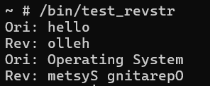

# Operating Systems Projects

Linux / RISC-V coursework by [huaien418](https://github.com/huaien418): custom system calls, pthread scheduling experiments, and a system-information character device module.

這份作品集展示我在作業系統課程中的三個實作：從 user/kernel 資料交換、執行緒排程，到 Linux 核心模組。保留課程程式與當時成果，並明確列出尚未完成的重新驗證工作。

| Project | Implementation | Evidence available |
| --- | --- | --- |
| [HW1 — System calls](hw1-system-calls/) | Linux 6.1 RISC-V patch: `revstr` and `tempbuf`, kernel configuration | Two original terminal images from the historical report |
| [HW2 — Scheduling](hw2-scheduling/) | pthreads, CPU affinity, NORMAL/FIFO policies, start barrier, per-thread CPU-time busy wait | Two original output images; historical test observations |
| [HW3 — kfetch](hw3-kfetch/) | Linux 6.8 RISC-V character device `/dev/kfetch`, selectable system information | Source and Makefile; historical execution images unavailable |

## Selected historical results

HW1 string reversal:

HW2 mixed NORMAL/FIFO scheduling:

These are original images extracted from my reports, not newly generated execution results. No kernel build, QEMU boot, scheduler experiment, or module load was performed while preparing this repository on 2026-10-19. See [validation status](VALIDATION.md).

## Repository scope

- Original algorithm and synchronization logic is preserved, including known limitations documented in each project.
- Publication edits remove student identifiers and school email, rename matching build targets, and replace the kernel local-version suffix. Original backups remain separate.
- Full reports, submission ZIPs, complete kernel trees, root filesystems, private keys, and course reference binaries are excluded.
- This is a portfolio archive. Complete reproducible environments and missing test programs still need to be supplied before a fresh end-to-end demonstration.

See [contributions](CONTRIBUTIONS.md), [source and evidence notes](SOURCE_NOTES.md), and the individual project READMEs for environment requirements and implementation details.

## Course references

The assignments and upstream Linux APIs define the exercise; the included submissions are my implementations. Assignment text and teaching staff examples are linked rather than republished.

- [HW1: compiling a custom kernel and adding system calls](https://hackmd.io/@fLANt9b6TbWx5I3lYKkBow/S17gcgmKxl). The live page now shows a 2026 revision; it is context, not a frozen specification of the original submission.
- [HW2: scheduling policy demonstration](https://hackmd.io/@seco1024/Bk48CgNClg).
- [HW3: system information fetching kernel module](https://hackmd.io/@seco1024/BJYIDp7lZx).

The separately supplied E3 assignment page requires university sign-in and was not available for inspection. No claims about hidden tests or grades are made.
