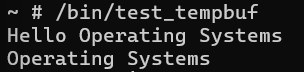

# Historical evidence

These two unmodified images were extracted from page 9 of the author's original HW1 report. They show user-space output from that historical environment; they were not captured during repository preparation.

The original report also contains a Linux version screenshot on page 2. That image is omitted because it includes identifying build metadata. The full report remains in the private source backup. These examples do not establish concurrency safety or comprehensive test coverage.
