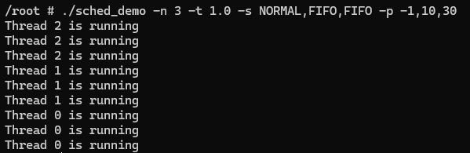
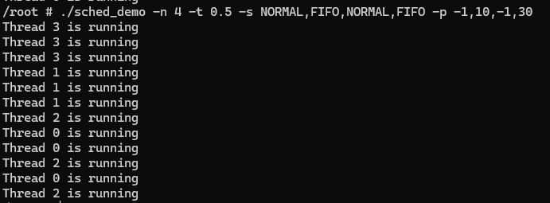

# Historical output and test observations

Both images are unmodified embedded images from the author's original HW2 report.

Page 5, NORMAL/FIFO/FIFO with priorities -1/10/30:

Page 6, NORMAL/FIFO/NORMAL/FIFO with priorities -1/10/-1/30:

The report's separate page-5 test screenshot shows `Result: Success!` for three cases: one NORMAL thread, two FIFO threads with priorities 10/20, and NORMAL/FIFO/FIFO with priorities -1/10/30. That screenshot is omitted because the command includes the original student identifier. This paragraph records an observation of that screenshot, not a fresh test run or a standalone reproduction log.

The staff test script and reference binary are not included in the original supplied files. No claim of current hidden-test success or a course grade is made.
